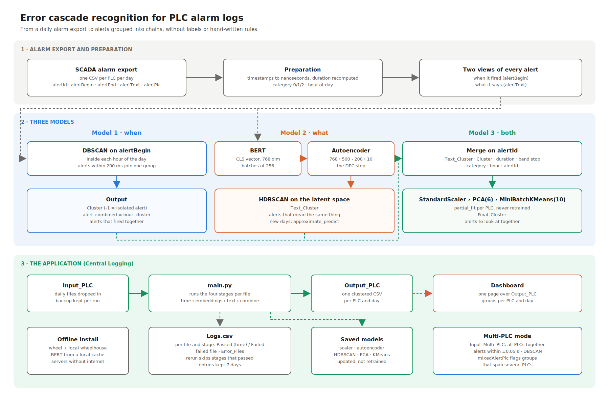
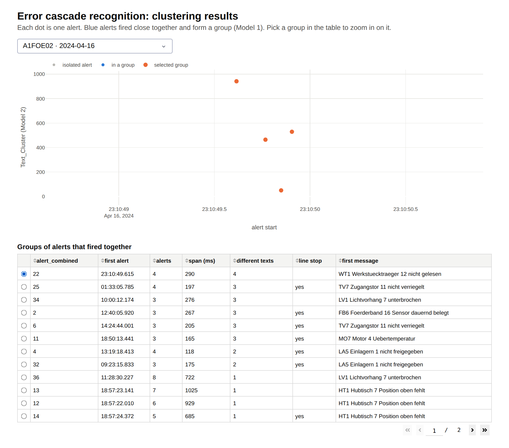

# Error Cascade Recognition

Master's project with **Volkswagen AG**, Emden (2024 to 2025), M.Eng. Industrial Informatics, Hochschule Emden/Leer.

Finds chains of related alarms in a car plant's PLC alarm log, without labels or hand-written rules, and runs as a daily application on the plant's servers.



## The problem

A fault on an assembly line rarely comes alone. A safety gate opens, the robot behind it stops, the conveyor backs up, and every station writes its own alarm. The log shows these as unrelated rows, so during a line stop the engineer has to work out which alarm came first while the line stands still. The brief from Volkswagen: find these chains, without hand-written rules, and keep the solution running after the project ends.

## What I built

1. **Model 1, when:** DBSCAN on the alert start time, inside each hour of the day. Alerts less than 200 ms apart form a group (`Cluster`, `alert_combined`).
2. **Model 2, what:** BERT embeddings of the alert text, an autoencoder from 768 down to 10 dimensions, then HDBSCAN (`Text_Cluster`).
3. **Model 3, both:** the two results merged on `alertId`, scaled, reduced with PCA and clustered with MiniBatchKMeans, updated PLC by PLC instead of retrained (`Final_Cluster`).
4. **The application:** one run per day over the PLC exports, a `Logs.csv` ledger with the status of every file and stage, failed files set aside, interrupted runs resumed, a multi-PLC mode, and an offline install for servers without internet.
5. A one-page dashboard over the output.

## Example

One PLC, one day. A group of four different messages within 290 ms, picked from the table and zoomed in:



## Results

**At Volkswagen** (reviewed by the plant's engineers)
- Single-PLC output: the groups were readable and matched failure modes the engineers knew.
- Multi-PLC output: some groups linked PLCs that sit far apart in the plant. Time alone is not enough across machines; the plant layout is needed.
- Packaged and installed for offline use on Windows servers.

**On generated data** (hidden labels; trained on week 1, scored on the daily runs of week 2, 525 PLC files)

| Model | Measured against | Result |
|---|---|---|
| Model 1, 200 ms, `min_samples` 3 (Project I) | cascades within each PLC file | finds **45%** of chain alerts; **58%** of grouped alerts belong to a chain |
| Model 1, 200 ms, `min_samples` 7 (application) | same | finds 0.1% of chain alerts; 98.5% of the alerts it groups come from repeating devices |
| Model 2 | fault family of each message | no group mixes fault families (homogeneity **0.94**); each family is split into many groups (completeness 0.37) |
| Model 3 | no labels | silhouette 0.18, Davies-Bouldin 1.15 (application settings); sorts alerts into line stops, long stoppages, organizational, other and short technical alerts |
| Multi-PLC | cascades across PLCs | of 1,858 groups spanning several PLCs, **62%** are real cascade links; **97%** of the coincidences join PLCs that are not neighbours |

Model 1 is very sensitive to `min_samples` and to the threshold; notebook 02 shows both sweeps. The multi-PLC numbers reproduce the engineers' finding: coincidences come from machines that can't affect each other.

What this means for maintenance, and how I would measure it in a pilot: [BUSINESS_CASE.md](BUSINESS_CASE.md)

## Repository

| Where | What |
|---|---|
| [`notebooks/`](notebooks) | The walkthrough, one notebook per stage, with saved outputs |
| [`01_alarm_log`](notebooks/01_alarm_log.ipynb) | The export format, the generated plant, what a cascade looks like |
| [`02_model1_temporal`](notebooks/02_model1_temporal.ipynb) | DBSCAN per hour, `alert_combined`, threshold and `min_samples` |
| [`03_model2_text`](notebooks/03_model2_text.ipynb) | BERT, autoencoder, HDBSCAN, groups per fault family |
| [`04_model3_combined`](notebooks/04_model3_combined.ipynb) | Merge, PCA, incremental MiniBatchKMeans, what each cluster holds |
| [`05_application`](notebooks/05_application.ipynb) | Daily runs, `Logs.csv`, a broken file, a resumed run, log retention |
| [`06_multi_plc`](notebooks/06_multi_plc.ipynb) | All PLCs together, ±0.05 s window, cascades versus coincidences |
| [`src/central_logging/`](src/central_logging) | The application: models, `main.py`, data generator, scoring |
| [`app/dashboard.py`](app/dashboard.py) | The dashboard page |
| [`results/`](results) | Scores, sweeps, cluster profiles, run ledger, sample output, figures |
| [`docs/`](docs) | Pipeline diagram, [offline install](docs/offline_install.md) |
| [`tests/`](tests) | The test cases: preprocessing, clustering, fusion, multi-PLC, ledger and resume |

**Stack:** Python, pandas, scikit-learn (DBSCAN, PCA, MiniBatchKMeans), HDBSCAN, PyTorch, Hugging Face Transformers (BERT), Dash, pytest.

## Run it

```bash
pip install -r requirements.txt
pip install -e .
python -m central_logging.benchmark --work work --results results   # generate, train, 7 daily runs, score
python app/dashboard.py results/sample_output                         # http://127.0.0.1:8050
pytest
```

BERT (`bert-base-uncased`) is loaded from the local cache and downloaded once if it is missing. `ECR_BERT_MODEL` can point to a folder with the model files.

## Notes

The plant data is under NDA, so this repository generates its own alarm log with the same columns: 75 PLCs on three lines, background faults, error cascades and repeating devices. The original data had 9.35M alerts from 75 PLCs over one year. No Volkswagen data, models or identifiers are included.
